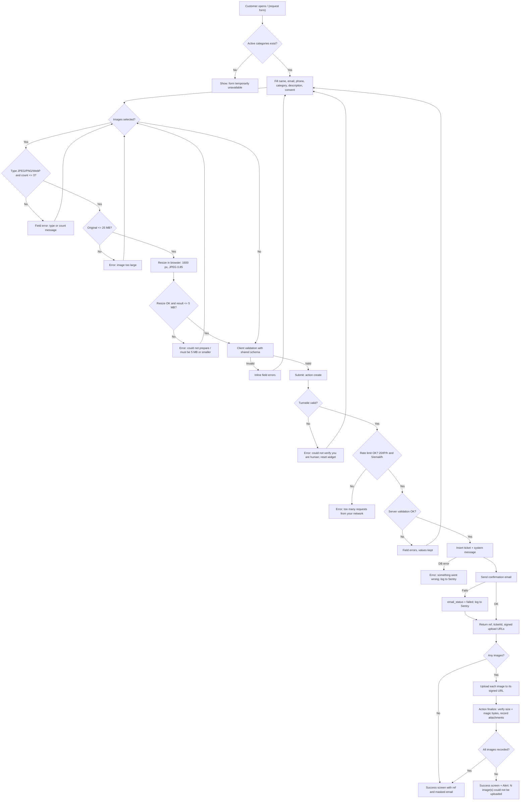
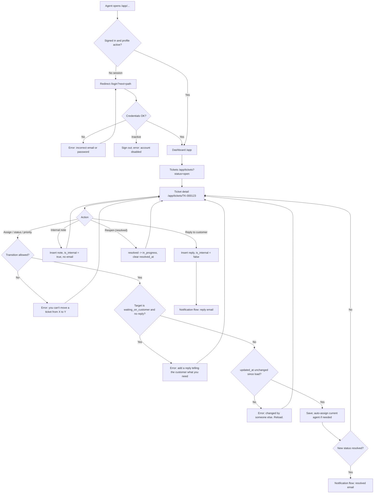
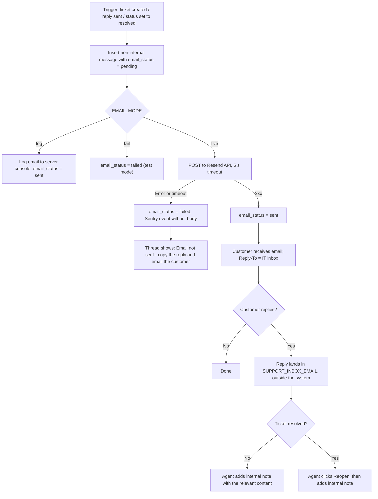

# 02 — User Flows and Screens

Use case IDs refer to [01-use-cases.md](01-use-cases.md). Visual design comes from `design-system/tms/` and is not specified here.

## Flow 1 — Public request (UC-01, UC-02)

Edge notes:

- **Double click:** submit button disabled while the action runs; a reused Turnstile token fails verification server-side.
- **Finalize window:** only accepted within 30 minutes of ticket creation and only for paths under `tickets/<ticketId>/`.
- **Shared school IP:** the IP limit is 20/hour because the whole school may share one public IP; Turnstile is the main bot defense.

## Flow 2 — Agent handling a ticket (UC-03 to UC-09)

Edge notes:

- **Two agents edit the same ticket:** ticket field updates use an `updated_at` check (optimistic concurrency). Notes and replies are append-only, so both succeed and appear in order.
- **Inactive assignee:** existing tickets keep the assignee, shown as "Name (inactive)"; the assignee dropdown lists active staff only.

## Flow 3 — Notification (UC-02, UC-10, UC-14)

Edge notes:

- **Customer replies to a resolved ticket:** handled outside the app (D1). The agent reopens manually. Nothing is automated.
- **No automatic retries** (keeps within Resend Free: 100 emails/day, 3,000/month).

## Screen list

| Screen | Route | Purpose | Who | Links to |
| --- | --- | --- | --- | --- |
| Request form | `/` | Submit a ticket with images; shows success state with ref after submit | Anyone | Privacy notice |
| Privacy notice | `/privacy` | What data is collected, why, who sees it, retention, contact (Data Privacy Act of 2012) | Anyone | Request form |
| Sign in | `/login` | Staff email + password sign-in | Staff | `/app` (after sign in) |
| Dashboard | `/app` | Open count, avg resolution (30 days), per-agent counts | Agent, Admin | Ticket list (each status count links to `/app/tickets?status=…`) |
| Ticket list | `/app/tickets` | List, filter by status, Mine toggle, pagination | Agent, Admin | Ticket detail |
| Ticket detail | `/app/tickets/[ref]` | Fields, attachments, thread, assign/status/priority, note/reply composer, reopen | Agent, Admin | Ticket list (back), mailto customer |
| Categories | `/app/admin/categories` | Add, rename, reorder, activate/deactivate | Admin | Dashboard |
| Team | `/app/admin/team` | Edit name, role, active; instructions to add users in Supabase | Admin | Dashboard |
| Not found | (error page) | 404 "Page not found." / "Ticket not found." | Anyone | `/` or `/app` |
| Forbidden | (error page) | 403 "You don't have access to this page." | Staff | `/app` |
| Health | `/health` | Plain `ok` for UptimeRobot (no UI) | Monitor | — |

AppShell navigation (staff): Dashboard, Tickets; Admin only: Categories, Team; user name + **Sign out**.
PublicShell: school name / "IT Help Desk" header, form or privacy content, footer link to Privacy notice.
