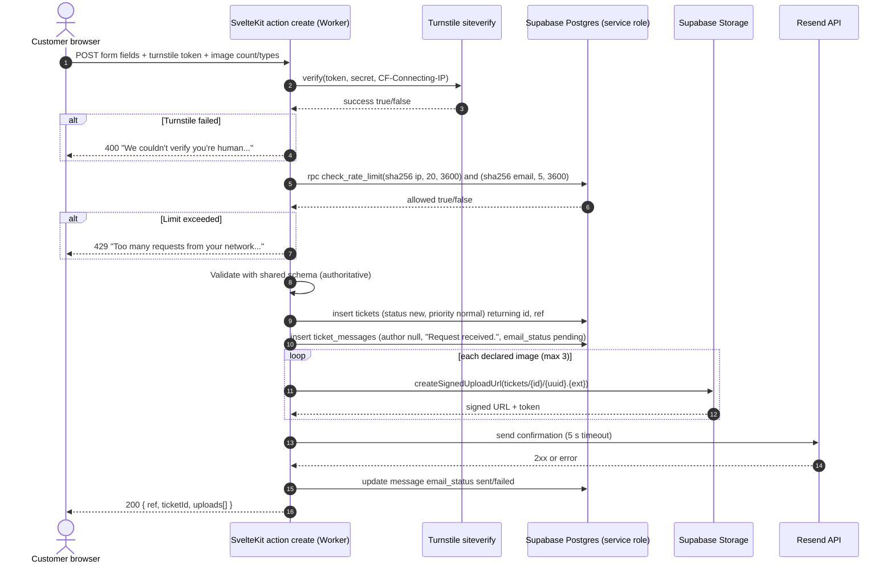
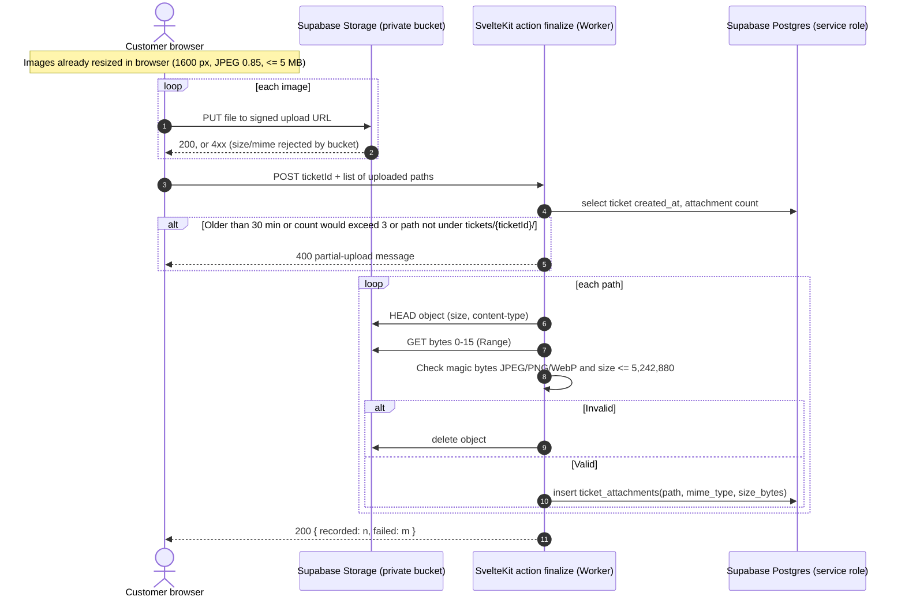
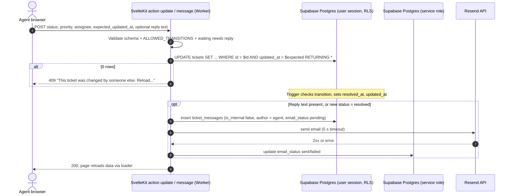

# 03 — System Flow

## Components and trust boundaries

| Zone | What runs there | Trust |
| --- | --- | --- |
| **Browser** | SvelteKit pages, client validation, image resize, Turnstile widget, direct upload to signed URLs | **Untrusted.** Everything it sends is re-validated. |
| **Cloudflare Worker** (SvelteKit server: `+page.server.ts`, `hooks.server.ts`, `$lib/server/*`) | Form actions, loaders, Turnstile verify, rate limiting, Supabase calls, email sending | **Trusted.** Holds secrets (`SUPABASE_SERVICE_ROLE_KEY`, `TURNSTILE_SECRET_KEY`, `RESEND_API_KEY`). |
| **Supabase** (Postgres, Auth, Storage — Singapore) | Data, RLS, constraints, triggers, private bucket | **Trusted, last line of defense.** RLS + CHECK constraints + triggers enforce rules even if app code is wrong. Service role bypasses RLS, so it is used only in specific server actions. |
| **External services** | Cloudflare Turnstile siteverify, Resend API, Sentry | Trusted for their single job; failures handled. |

Two Supabase clients on the server:

- `locals.supabase` — per-request client with the user's session cookies (anon key + user JWT). Used for **all staff reads and writes** so RLS applies.
- `supabaseAdmin` in `src/lib/server/supabase-admin.ts` — service role. Used **only** for: anonymous ticket creation, rate-limit RPC, issuing signed upload URLs, finalize verification, attachment inserts, system messages, and `email_status` updates.

## Where validation happens

| Check | Browser | Worker | Database / Storage |
| --- | --- | --- | --- |
| Field rules (lengths, email, phone) | Shared Zod schema (UX only) | **Same schema, authoritative** | CHECK constraints (backstop) |
| Category is active | Select options | Lookup active category | FK to `categories` |
| Human check | Turnstile widget | **siteverify** (token, secret, remote IP) | — |
| Rate limit | — | **RPC `check_rate_limit`** | Table + function |
| Image type / size | Accept list, resize, size check | **Finalize: HEAD size + first 16 bytes magic check** | Bucket `allowed_mime_types` + `file_size_limit` 5 MB |
| Max 3 images | UI | Count in finalize | Trigger `enforce_max_attachments` |
| Status transitions | Only offers allowed targets | **Shared `ALLOWED_TRANSITIONS` map** | Trigger `tickets_before_update` |
| Status/assignee invariant | — | Auto-assign logic | CHECK `(status = 'new') = (assignee_id IS NULL)` |
| Concurrency | Hidden `expected_updated_at` | `UPDATE … WHERE updated_at = $expected` | — |
| Role (admin pages) | Nav hides links | `+layout.server.ts` returns 403 | RLS `is_admin()` |
| Output escaping | Svelte escapes by default; no `{@html}` | Email templates escape user text | — |
| CSRF | — | SvelteKit built-in origin check on form actions | — |

## Sequence 1 — Ticket creation

## Sequence 2 — Image upload with signed URLs

Assumption: Supabase Storage honours the HTTP `Range` header on authenticated downloads. Fallback if not: download the whole object (≤ 5 MB; network I/O, not CPU) and read the first 16 bytes.

## Sequence 3 — Agent update with notification

Note: the two writes (ticket update + message insert) are not in one transaction because supabase-js has no client transactions. Order is update first, then message. If the message insert fails after the update succeeded, the agent sees "Status saved, but the reply was not saved. Please send it again." (Assumption: acceptable for MVP; alternative is a single Postgres RPC — see 06.)

## Cloudflare Workers limits and how the design fits

| Limit (Free plan) | Design response |
| --- | --- |
| **10 ms CPU per request** | All heavy work is network I/O (Turnstile, Supabase, Resend, Storage), which counts as wall time, not CPU. No image processing on the server: resize happens in the browser. Magic-byte check reads 16 bytes. No PDF, no zip, no crypto beyond one SHA-256 of IP/email (Web Crypto, microseconds). |
| **No local disk** | Nothing written to the filesystem. Files go browser → Storage directly; data in Postgres; logs to Sentry/console. |
| **No Node-only APIs** | Use Web APIs only: `fetch`, `crypto.subtle`, `Request/Response`. supabase-js and Zod run on Workers. Resend called with `fetch` (no SDK needed). |
| **Request body size** | Images never pass through the Worker, so the form POST is a few KB. |
| **Subrequests (50 per request on Free)** | Create action ≈ 10 subrequests (1 Turnstile + 2 rate-limit + 2 inserts + up to 3 signed URLs + 1 email + 1 status update). Finalize ≈ 10 (1 select + 3 × (HEAD + GET + insert/delete)). |
| **Worker script size (3 MB compressed on Free)** | Keep dependencies minimal; check `wrangler deploy --dry-run` size in Slice 12 after adding Sentry. |
| **100,000 requests/day** | A school help desk uses a tiny fraction; UptimeRobot every 5 min = 288/day. |
