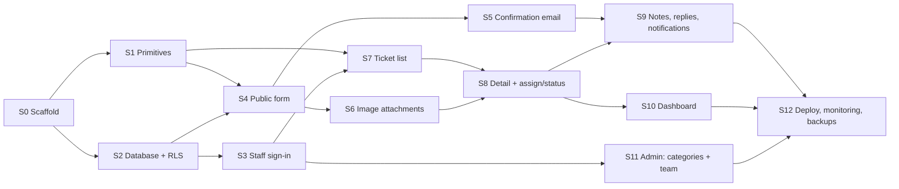

# 05 — Build Plan (vertical slices)

Each slice is one focused session, ends demoable, and follows the AGENTS.md change workflow: read → smallest change → add test → run `npm run check`, `npm run test` (and Playwright for user-facing changes) → report results honestly.

## Dependencies to approve before Slice 0

| Package | Why | Slice |
| --- | --- | --- |
| `@sveltejs/kit`, `svelte`, `vite`, `typescript`, `svelte-check` | Stack (AGENTS.md) | 0 |
| `@sveltejs/adapter-cloudflare`, `wrangler` (dev) | Hosting (AGENTS.md) | 0 |
| `tailwindcss`, `@tailwindcss/vite` | Styling (AGENTS.md) | 0 |
| `vitest` (dev), `@playwright/test` (dev) | Tests (AGENTS.md commands) | 0 |
| `zod` | Shared validation (AGENTS.md) | 4 |
| `@supabase/supabase-js`, `@supabase/ssr` | Supabase client + cookie sessions | 2, 3 |
| `supabase` CLI (dev) | Local DB, migrations, type gen (AGENTS.md commands) | 2 |
| `@sentry/sveltekit` | Monitoring (AGENTS.md) | 12 |

Not added: Resend SDK (plain `fetch` is enough), image libraries (canvas API), date libraries (`Intl.DateTimeFormat` with `timeZone: 'Asia/Manila'`), UI kits, Turnstile packages (script tag).

Local prerequisite: **Docker Desktop** for `supabase start` (free). See 06 risk R5 for the fallback.

## Slice map

---

## S0 — Scaffold and tooling

- **Goal:** Empty SvelteKit app that builds for Cloudflare, with tokens wired and test runners working.
- **Depends on:** nothing.
- **Files:** `package.json`, `svelte.config.js` (adapter-cloudflare), `vite.config.ts` (Tailwind plugin, Vitest), `tsconfig.json` (strict), `wrangler.toml`, `src/app.html` (font links from `design-system/tms/tokens.css` header), `src/app.css` (tokens + `@theme inline`), `src/routes/+page.svelte` (placeholder), `playwright.config.ts`, `tests/e2e/smoke.spec.ts`, `.env.example`, `.gitignore`, `README.md` (commands). `git init`. Optional (needs approval): move `docs/AGENTS.md` to repo root.
- **Skills:** `sveltekit`, `tailwind-patterns`, `secrets-management` (env layout).
- **Tests:** Playwright `smoke.spec.ts`: `/` returns 200 and has `<html lang="en">`; Vitest sample test passes.
- **Done when:**
  - [ ] `npm run dev`, `npm run check`, `npm run test`, `npm run build` all pass.
  - [ ] `npx playwright test` passes.
  - [ ] `.env` is git-ignored; `.env.example` lists every variable from 04 with no values.
  - [ ] Body text uses `--color-text` on `--color-bg` in light and dark (`prefers-color-scheme`).

## S1 — UI primitives and layouts

- **Goal:** Reusable primitives from AGENTS.md so pages never restyle elements.
- **Depends on:** S0.
- **Files:** `src/lib/components/ui/{Button,Input,Textarea,Select,Field,Card,Badge,Table,Modal,Alert,PageHeader}.svelte`, `src/lib/components/layout/{AppShell,PublicShell}.svelte`, `src/lib/ui/status.ts` (status + priority → label + badge tokens), `src/routes/dev/styleguide/+page.svelte` (returns 404 unless `dev`).
- **Skills:** `tailwind-patterns`, `design-token-contrast`, `sveltekit`.
- **Tests:** Vitest: `status.ts` returns a label for every status and priority value. Playwright: styleguide renders every primitive; Tab key shows a visible focus ring on Button and Input; `Field` links `<label for>` to the control and `aria-describedby` to the error.
- **Done when:**
  - [ ] No arbitrary Tailwind values (`grep -E "\[#|\[[0-9]+px\]" src` returns nothing).
  - [ ] `design-token-contrast` check passes for light and dark.
  - [ ] Badge always renders a text label.
  - [ ] Styleguide route is unreachable in a production build.

## S2 — Database, RLS and storage

- **Goal:** Full schema from 04 with RLS, triggers, bucket and seed, verified by tests.
- **Depends on:** S0.
- **Files:** `supabase/config.toml`, `supabase/migrations/0001_schema.sql` (tables, checks, indexes, sequence), `0002_functions_triggers.sql` (`is_staff`, `is_admin`, transitions trigger, attachments trigger, profile triggers, `check_rate_limit`, `dashboard_stats`), `0003_rls.sql`, `0004_storage.sql` (bucket + policies), `supabase/seed.sql` (8 categories; local users: `admin@test.local`, `agent1@test.local`, `agent2@test.local`, `inactive@test.local`), `src/lib/database.types.ts` (generated), `tests/db/rls.test.ts`, `tests/db/transitions.test.ts`.
- **Skills:** `supabase-postgres-best-practices`, `secrets-management`.
- **Tests (Vitest against local Supabase):**
  - anon cannot SELECT/INSERT `tickets`, `ticket_messages`, `ticket_attachments`, `profiles`, `rate_limits`; anon can SELECT only active categories.
  - agent can SELECT/UPDATE tickets; cannot INSERT/UPDATE categories; cannot UPDATE profiles; cannot INSERT a message with another `author_id`.
  - admin can INSERT/UPDATE categories and UPDATE other profiles; cannot change own role/active.
  - inactive user sees nothing.
  - every cell of the transition table: allowed succeeds, disallowed raises.
  - status/assignee and resolved_at CHECKs hold; 4th attachment insert raises.
  - `check_rate_limit` returns false on call `limit + 1`; anon/authenticated cannot execute it.
- **Done when:**
  - [ ] `supabase db reset` applies cleanly from zero.
  - [ ] All DB tests pass.
  - [ ] Types regenerated and committed.
  - [ ] RLS enabled on every table (test queries `pg_tables.rowsecurity`).

## S3 — Staff sign-in and guarded app shell

- **Goal:** Staff can sign in/out; `/app/*` is protected; admin-only routes return 403 for agents.
- **Depends on:** S2 (S1 for AppShell).
- **Files:** `src/hooks.server.ts` (`@supabase/ssr` client in `locals`, `safeGetSession` via `getUser()`, profile load, inactive → sign out), `src/app.d.ts`, `src/routes/login/+page.svelte`, `+page.server.ts`, `src/routes/logout/+page.server.ts`, `src/routes/app/+layout.server.ts` (guard + profile), `src/routes/app/+layout.svelte` (AppShell), `src/routes/app/+page.svelte` (placeholder dashboard), `src/routes/app/admin/+layout.server.ts` (403 unless admin), `src/lib/server/safe-redirect.ts`.
- **Skills:** `sveltekit`, `secrets-management`.
- **Tests:** Vitest: `safe-redirect` accepts `/app/x`, rejects `https://evil.example`, `//evil`, `/login`. Playwright: AC-03.1 to AC-03.6; agent gets 403 on `/app/admin/categories`.
- **Done when:**
  - [ ] All UC-03 acceptance criteria pass in Playwright.
  - [ ] No service role key used in this slice.

## S4 — Public request form (no images, no email)

- **Goal:** Customer submits a ticket; it is stored safely.
- **Depends on:** S1, S2.
- **Files:** `src/lib/schemas/ticket.ts` (shared Zod schema + messages from UC-01), `src/lib/server/supabase-admin.ts`, `src/lib/server/turnstile.ts`, `src/lib/server/rate-limit.ts` (SHA-256 key, RPC call), `src/lib/server/log.ts` (`logError` → console now, Sentry in S12), `src/routes/+page.svelte`, `src/routes/+page.server.ts` (`load` categories; `?/create`), `src/routes/privacy/+page.svelte` (placeholder text, final copy in S12), `src/lib/utils/mask-email.ts`.
- **Skills:** `sveltekit`, `secrets-management`, `supabase-postgres-best-practices`.
- **Tests:**
  - Vitest: schema accepts a valid payload; each invalid field returns the exact message; `mask-email` (`juan@gmail.com` → `j***@gmail.com`); CR/LF in name rejected.
  - Playwright (Turnstile test keys: always-pass site/secret for success; always-fail secret for AC-01.4 — exact test key values from Cloudflare docs, verify): AC-01.1–01.5, AC-01.9, AC-01.11 (submit then check DB row text).
  - Rate limit test runs with `RATE_LIMIT_IP_PER_HOUR=2`.
- **Done when:**
  - [ ] Ticket created with correct defaults and ref format.
  - [ ] All UC-01 non-image criteria pass.
  - [ ] Form works with JavaScript disabled (progressive enhancement), except Turnstile which requires JS — show "Please enable JavaScript to submit this form." in `<noscript>`.

## S5 — Confirmation email

- **Goal:** Customer receives a confirmation; delivery status is recorded.
- **Depends on:** S4.
- **Files:** `src/lib/server/email/send.ts` (`EMAIL_MODE` live/log/fail, Resend `fetch`, 5 s timeout, no retries), `src/lib/server/email/templates.ts` (confirmation, reply, resolved; text + escaped HTML), `src/lib/server/email/escape.ts`, update `src/routes/+page.server.ts`.
- **Skills:** `secrets-management`, `sveltekit`.
- **Tests:** Vitest: templates escape `<`, `>`, `&`, `"`, `'`; subjects match `^\[TK-\d{6}\] `; Reply-To set; `send.ts` maps non-2xx and timeout to `failed` (mock `fetch`). Playwright: AC-02.1 (log mode), AC-02.2 (fail mode).
- **Done when:**
  - [ ] UC-02 criteria pass.
  - [ ] No email body or recipient address is sent to logs in `live` mode errors (only ticket ref + status code).

## S6 — Image attachments

- **Goal:** Up to 3 images resized in the browser, uploaded via signed URLs, verified and recorded.
- **Depends on:** S4.
- **Files:** `src/lib/client/resize-image.ts` (canvas, longest side 1600, JPEG 0.85, 25 MB input cap), `src/lib/server/attachments.ts` (path builder, magic-byte check, finalize logic), update `src/routes/+page.server.ts` (`?/create` returns uploads; `?/finalize`), update `src/routes/+page.svelte` (file picker, previews, per-file errors, partial-upload Alert), `tests/fixtures/{photo.jpg,shot.png,pic.webp,fake.jpg(gif bytes),big.jpg}`.
- **Skills:** `sveltekit`, `supabase-postgres-best-practices`.
- **Tests:** Vitest: magic-byte detector for JPEG/PNG/WebP/GIF/HTML; resize dimension math (4000×3000 → 1600×1200; 800×600 unchanged); path builder matches the CHECK regex. Playwright: AC-01.6, AC-01.7, AC-01.8, AC-01.10; finalize after 30 min rejected (test sets ticket `created_at` back via service role).
- **Done when:**
  - [ ] UC-01 image criteria pass.
  - [ ] Storage contains only paths matching the format; no original filenames.
  - [ ] Bucket rejects a direct 6 MB upload.

## S7 — Ticket list and filters

- **Goal:** Staff see and filter tickets.
- **Depends on:** S1, S3.
- **Files:** `src/routes/app/tickets/+page.server.ts`, `+page.svelte`, `src/lib/utils/format-date.ts` (Asia/Manila, relative + absolute), `src/lib/tickets/filters.ts` (parse `status`, `mine`, `page`).
- **Skills:** `sveltekit`, `supabase-postgres-best-practices`.
- **Tests:** Vitest: filter parsing (unknown status → `open`; page < 1 → 1); date formatting in Asia/Manila. Playwright with seeded tickets: AC-04.1–04.6.
- **Done when:**
  - [ ] UC-04 criteria pass.
  - [ ] Query uses the `(status, created_at)` index (check `explain` once).

## S8 — Ticket detail: assign, status, priority, reopen

- **Goal:** Staff open a ticket, see attachments, and change assignee/status/priority safely.
- **Depends on:** S6, S7.
- **Files:** `src/routes/app/tickets/[ref]/+page.server.ts` (load ticket, messages, attachments with signed URLs, active staff; `?/update`), `+page.svelte`, `src/lib/tickets/transitions.ts` (`ALLOWED_TRANSITIONS`, `nextStatusForAssignee`), `src/lib/schemas/ticket-update.ts`.
- **Skills:** `sveltekit`, `supabase-postgres-best-practices`.
- **Tests:** Vitest: every transition-table cell; auto-assign rules; unassign → `new`. Playwright: AC-05.1–05.4, AC-06.1–06.5, AC-07.1, 07.2, 07.4, 07.5; **conflict test** with two browser contexts editing the same ticket (second save shows conflict message).
- **Done when:**
  - [ ] UC-05, UC-06 and UC-07 (except email parts) pass.
  - [ ] TS map and DB trigger agree (shared test cases).

## S9 — Internal notes, replies and notifications

- **Goal:** Staff add internal notes or customer replies; customers are emailed on replies and resolution.
- **Depends on:** S5, S8.
- **Files:** update `src/routes/app/tickets/[ref]/+page.server.ts` (`?/note`, `?/reply`; resolved + waiting rules in `?/update`), `+page.svelte` (composer with Internal note default, Send reply label, thread with labels and email status), `src/lib/schemas/message.ts`.
- **Skills:** `sveltekit`, `playwright-skill`, `e2e-testing`.
- **Tests:** Vitest: message schema messages. Playwright: AC-07.3, AC-08.1–08.3, AC-09.1–09.3, AC-10.1–10.3, AC-14.2; **Definition-of-done smoke test** `tests/e2e/smoke-flow.spec.ts`: submit ticket → agent signs in and sees it → agent replies → reply has `email_status = 'sent'` (log mode).
- **Done when:**
  - [ ] Smoke flow passes.
  - [ ] Internal-note marker text never appears in any sent email (AC-10.2).

## S10 — Dashboard

- **Goal:** Open count, average resolution (30 days), tickets per agent.
- **Depends on:** S8.
- **Files:** `src/routes/app/+page.server.ts`, `src/routes/app/+page.svelte`, `src/lib/utils/format-duration.ts`; uses `dashboard_stats()` from S2.
- **Skills:** `sveltekit`, `supabase-postgres-best-practices`.
- **Tests:** Vitest: `format-duration` (10800 s → `3h 0m`; 100000 s → `1d 3h`; null → `—`); DB test for `dashboard_stats()` with fixed seed. Playwright: AC-11.1–11.3.
- **Done when:**
  - [ ] UC-11 criteria pass; status counts link to the filtered list.

## S11 — Admin: categories and team

- **Goal:** Admin manages categories and staff role/active.
- **Depends on:** S3.
- **Files:** `src/routes/app/admin/categories/+page.server.ts`, `+page.svelte`, `src/routes/app/admin/team/+page.server.ts`, `+page.svelte`, `src/lib/schemas/category.ts`, `src/lib/schemas/profile.ts`.
- **Skills:** `sveltekit`, `supabase-postgres-best-practices`.
- **Tests:** Vitest: schema messages. Playwright: AC-12.1–12.4, AC-13.1–13.3.
- **Done when:**
  - [ ] UC-12 and UC-13 criteria pass.
  - [ ] Team page shows the "Add users in Supabase → Authentication → Add user" instruction.

## S12 — Deploy, monitoring, backups

- **Goal:** Production on free tiers, monitored, with a backup routine and runbook.
- **Depends on:** S9, S10, S11.
- **Files:** `src/hooks.server.ts` + `src/hooks.client.ts` (Sentry init; `logError` → Sentry; scrub emails/descriptions from events), `src/routes/health/+server.ts` (anon `select id from categories limit 1` → `ok` or 503), `src/routes/privacy/+page.svelte` (final copy, reviewed by the school), `docs/runbook.md` (deploy steps, secrets list, create first admin SQL, add staff, reset password in Supabase, weekly backup, restore, Resend domain setup, what to do if Supabase pauses), `.github/` not required.
- **Skills:** `pre-release-review`, `frontend-lighthouse` (public form on mobile), `secrets-management`. `production-audit` only with your approval (it calls an external API).
- **Steps:**
  1. Create Supabase project (Free, Singapore); `supabase link`; `supabase db push`.
  2. Create first admin in Supabase dashboard; promote with the runbook SQL.
  3. Turnstile production widget for the production hostname.
  4. Resend: verify sending domain (see 06 R1); set `EMAIL_MODE=live`.
  5. Cloudflare: set secrets with `wrangler secret put`; `npx wrangler deploy`.
  6. Sentry project (Developer plan); set DSN.
  7. UptimeRobot HTTP monitor on `/health` every 5 minutes (also keeps Supabase Free active — assumption, see 06 R2).
  8. Backups: weekly `supabase db dump` (schema + data) by the admin, stored in the school's Google Drive with restricted sharing; restore test once before go-live.
- **Tests:** Playwright smoke flow against production with a dedicated test category (or a staging Supabase project if you prefer — open question). Lighthouse on `/`: Performance ≥ 90, Accessibility ≥ 95 on mobile.
- **Done when:**
  - [ ] `pre-release-review` has no blockers.
  - [ ] Real email received at a test inbox; Reply-To correct.
  - [ ] Sentry receives a deliberate test error with no personal data.
  - [ ] UptimeRobot shows `/health` up.
  - [ ] A backup was taken and restored into a local Supabase successfully.
  - [ ] Worker bundle under the Free size limit.
